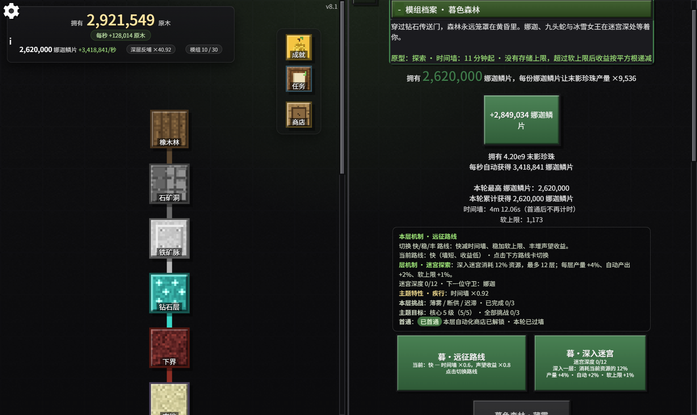
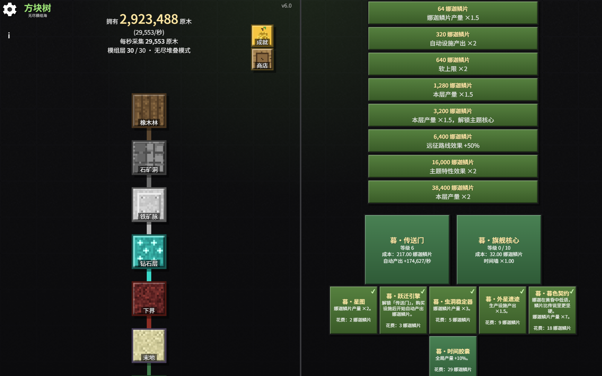
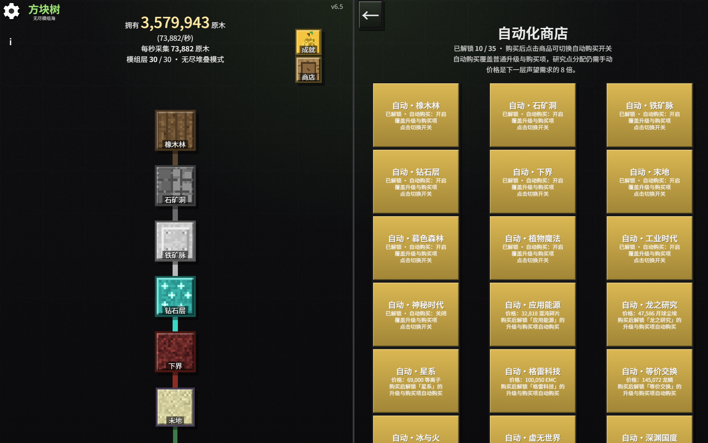
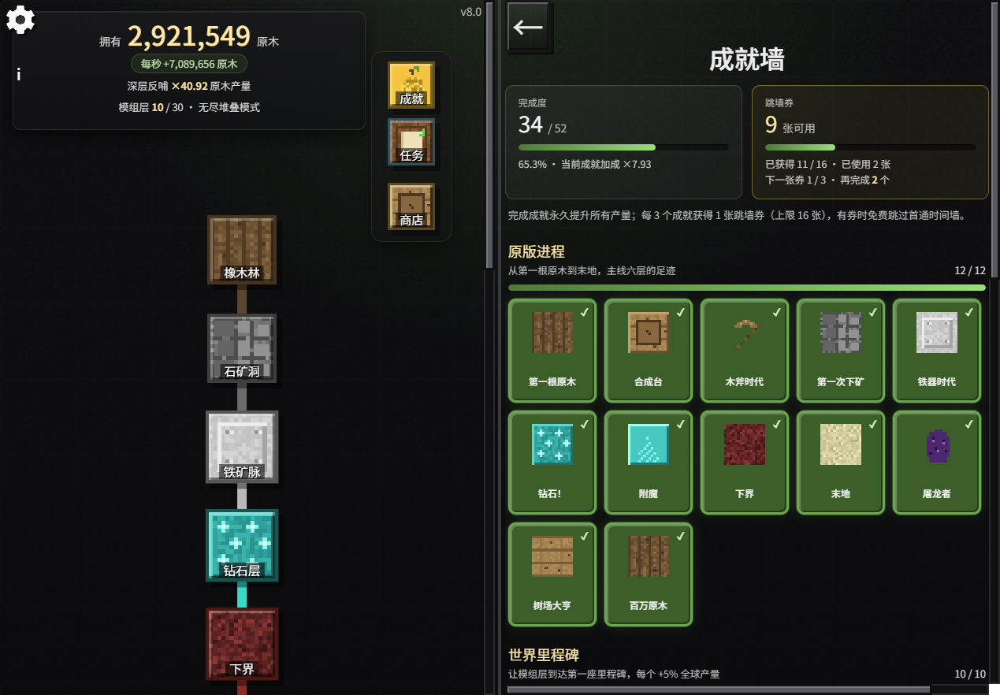

# 方块树：无尽模组海 · Block Tree Modpack

一个以《Minecraft》及其整合包为主题的网页放置游戏，基于 [The Modding Tree](https://github.com/Acamaeda/The-Modding-Tree) 引擎二次创作。

从徒手撸树开始，一路推进 30 个模组维度。每个模组层都有自己的首通施工与软上限；没有存储上限，也没有固定通关时长，能堆多少堆多少。

## 规模

- **36 层科技树**：6 个原版维度 + 30 个模组维度
- **每个模组层**：10 个升级、4 座自动化设施 + 主题核心、10 个里程碑、3 个挑战
- 合计 **300 个模组升级、150 座设施、300 个里程碑、90 个挑战**
- **5 套原型机制、8 类主题特性、30 个主题签名升级、每层 1 套层机制**（前 6 层专属，其余 24 层从 8 套模板的各 3 个变体中轮换）
- 每层页顶的「本层规则」卡集中显示机制、特性、挑战与主题目标；挑战条件逐层轮换，首通后标记徽章
- **52 个成就**，其中 30 个为模组层专属；成就只提供全局产出加成（原版成就 +1%～+5%、模组投产 +1.5%、世界里程碑 +5%，全部加法叠加）
- 侧边 **层间任务**：13 个跨层目标（首通、挑战、全清、自动化、深层反哺、声望次数），自动完成并即时加成全局产量，全部完成合计 +92%；进度只增不减
- **深层反哺**：第三层起，每层的历史最高资源都会永久提升原木基础产量，声望与级联重置不会清零；顶部显示当前倍率
- 侧边 **自动化商店**：每层首通后可用本层资源购买本层自动化，自动购买升级与购买项（研究分支除外）并自动声望，购买后可随时开关；自动声望不会回退到上次声望的下限以下
- 每个模组层各自拥有首通施工与软上限（原版六层没有）；本层资源本身没有上限，越往后收益递减越明显
- 声望是级联的：每次最多回退本层及下面 4 层，更低层的点数与资源（原木、木板、圆石等）原样保留；被回退的更低层施工进度、升级、设施与里程碑会从头开始（已首通层保留 12 号升级与 1 级生产设施），本层点数与升级保留；挑战完成记录与奖励则永久保留
- 无尽模式：没有 1000 小时终点，也没有固定通关倒计时
- 侧边 **模组记忆**：首通 30 个模组层后开放**真转生** —— 除记忆等级与记忆点外，资源、升级、首通标记、成就、任务、商店与深层反哺全部清零；记忆点按累计模组声望的平方根 ×1.5 发放，可换成 8 条永久升级线（全局产量、软上限、起手设施、自动声望阈值、施工需求、模组声望收益、模组自动产出、深层反哺指数）

## 界面预览

| 科技树 | 橡木林 |
| :---: | :---: |
|  |  |
| **暮色森林 · 施工与软上限** | **模组层设施与升级** |
|  |  |
| **自动化商店** | **成就墙** |
|  |  |

## 30 个模组维度

暮色森林、植物魔法、工业时代、神秘时代、应用能源、龙之研究、星系、格雷科技、等价交换、冰与火、虚无世界、深渊国度、沉浸工程、匠魂、林业、热力膨胀、末影接口、超能物质、核科技、反应堆、神秘农业、血魔法、巫术、新生魔艺、天境、环境科技、实用存储、铁路、无尽贪婪、创造模式。

每一层都有独立的资源链：既反哺上一层的声望收益，也把历史最高资源折算成永久的原木基础产量加成。

## 每层的差异化

30 个模组层按 5 种原型生成，数值、节奏与软上限各不相同：

| 原型 | 特点 |
| --- | --- |
| 采集 | 自动化产出高，施工需求较低，适合滚雪球 |
| 科技 | 升级倍率高、造价高，依赖设施联动 |
| 魔法 | 软上限更高，后期空间大 |
| 工业 | 增益设施强，产量成长快 |
| 探索 | 软上限最高、施工需求最高，单层收益最大 |

五类原型各带一套可操作机制：采集的自动产出随施工进度递增，科技用声望积攒研究点并投入三条分支，魔法可以消耗资源施放短时声望 Buff，工业的设施互相加成，探索可在快/稳/丰三条远征路线间切换。

30 个主题还各有一条特性（产量、软上限、施工需求、设施造价、升级造价、里程碑需求、自动产出、全局产量共 8 类模板），15 号升级则换成每层专属的签名升级，标题与文案逐层不同，倍率分 7× / 8× / 10× 三档。

30 个模组层还各有 1 套「层机制」，与原型机制叠加：前 6 层为专属玩法——暮色森林深入迷宫、植物魔法照料魔力花圃、工业时代切换电压档位、神秘时代开启虚空凝视、应用能源调整网络优先级、龙之研究拨动混沌风险；其余 24 层从潮汐、轮转、回响、矩阵、赌局、储备、过载、共鸣 8 套模板中轮换，每套模板有 3 个变体（例如潮汐分缓潮、快潮、长潮），同一模板在不同层的节奏与数值都不相同。规则卡会显示当前状态、倍率与变体名，可操作的机制在层页面提供专属卡片。

每层另有 3 个挑战与第 5 座设施「主题核心」：挑战条件从薄雾（软上限 ×0.5）、断供（自动产出 ×0.25）、迟滞（声望收益 ×0.6）、封存（签名升级失效）、失谐（主题特性失效）、熄核（主题核心失效）中按层轮换，名称随主题；完成奖励仍为产量、软上限、自动产出。主题核心的 10 级效果跟随本层特性，6 号与 7 号里程碑分别把特性翻倍、再给一层产量翻倍，8/9 号里程碑分别奖励主题核心 5 级与完成全部挑战。

每层还会根据层级调整：

- 资源需求与声望指数
- 施工需求（基础等于 `req`，再乘原型倍率 0.9–1.2，随层级提高；升级与设施最多压缩 50%）
- 软上限倍率
- 升级与设施造价
- 升级名称、模组主题、贴图与颜色

## 首通施工 / 软上限

- **首通施工**：首通前要用上一层资源投入材料推进施工，投入满额时声望收益 100%；没投满也能提前声望，收益按施工进度从 30% 线性折算。升级与设施可以降低施工需求，每层首次声望通过后不再检查施工。施工没有跳过手段，只能靠投入材料推进。
- **软上限**：声望收益超过软上限后按平方根折算，防止单次爆发过强。
- **没有存储上限**：本层资源、`best` 与累计总量都可以无限增长；软上限只压缩单次声望的收益，不封锁继续推进。
- 模组层的全局加成改为线性叠加（模组 21 号升级每层 +10%，原版六层的 21 号仍为乘算），避免 30 层倍率相乘导致数值直接爆炸。

## 难度

- 全局难度 **+400%（×5.0）**：所有声望需求、升级价格和自动化造价乘以 `5.0`。
- 后期层级的原始需求约 3.3e6，乘难度后约 1.7e7；声望指数从 0.44 平滑降到 0.237，单层仍需长时间挂机，但不会在最后几层突然变平。
- 没有固定 1000 小时终点；内容长度由 30 层的数值增长与收益递减共同决定。

## 文档

项目文档入口：[docs/!general-info.md](docs/!general-info.md)。

- [玩法与进度](docs/gameplay.md)
- [数值与平衡](docs/balance.md)
- [开发指南](docs/development.md)
- [成就系统](docs/achievements.md)
- [自动化商店](docs/shop.md)

## 目录

- `js/mod.js` — 模组信息、原木产量、全局倍率、难度系数、无尽模式。
- `js/layers/overworld.js` — 橡木林、石矿洞、铁矿脉、钻石层。
- `js/layers/nether_end.js` — 下界、末地。
- `js/layers/modpack.js` — 30 个模组层、首通施工与软上限工厂。
- `js/layers/achievements.js` — 52 个成就。
- `js/layers/shop.js` — 自动化商店（侧边层）。
- `js/layers/quests.js` — 13 个层间任务与全局产量奖励。
- `js/tree.js` — 科技树入口。
- `css/minecraft.css` — 像素方块风格界面。
- `img/` — 程序生成的原创 16×16 像素贴图（`tools/generate_textures.py` 可重新生成）。
- `tools/generate_textures.py` — 贴图生成脚本。

## 说明

- 本项目是非商业同人作品，与 Mojang Studios / Microsoft 无关；Minecraft 是其各自的商标。
- 所有贴图均为本项目原创绘制的像素画，没有直接使用游戏内素材。
- 模组名称仅用于致敬与说明，不包含任何模组的实际代码或素材。
- 游戏引擎与原始模板版权归 The Modding Tree 作者所有，详见 `LICENSE` 与 `Prestige-tree-license`。
