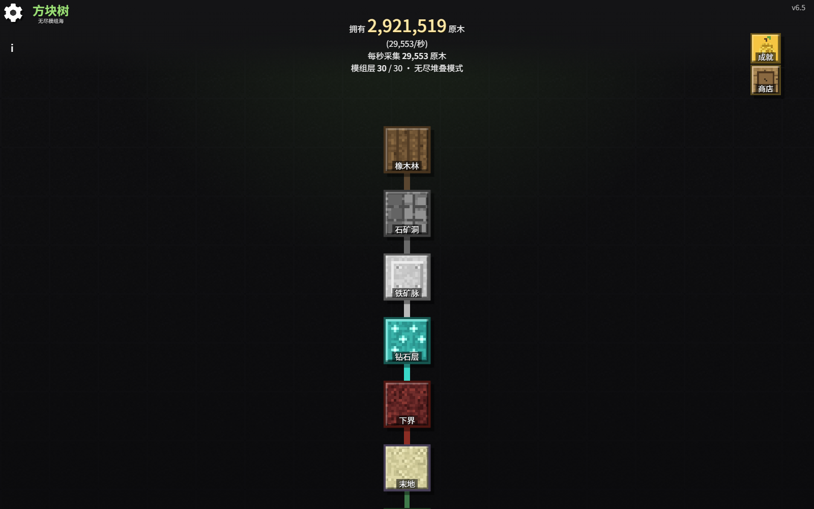
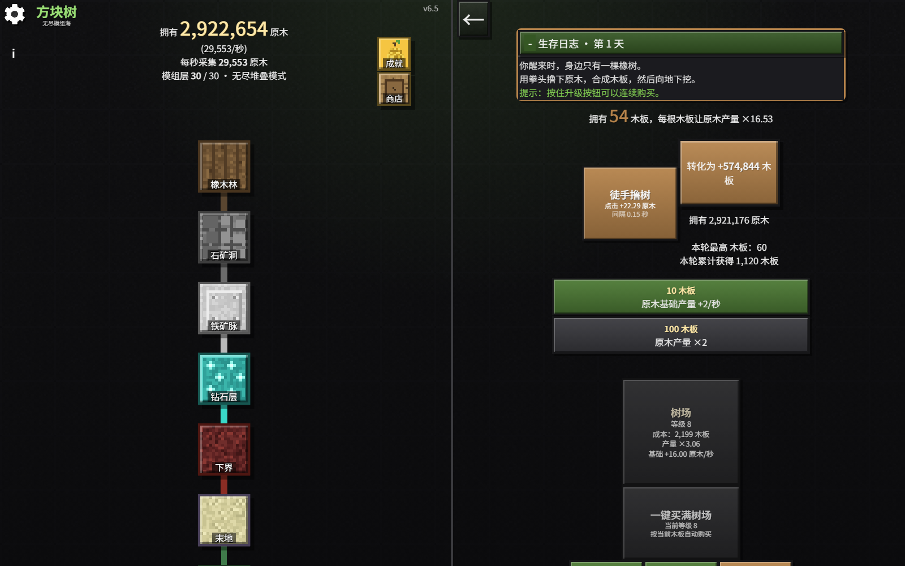

# 方块树：无尽模组海 · Block Tree Modpack

一个以《Minecraft》及其整合包为主题的网页放置游戏，基于 [The Modding Tree](https://github.com/Acamaeda/The-Modding-Tree) 引擎二次创作。

从徒手撸树开始，一路推进 30 个模组维度。每个模组层都有自己的时间墙与软上限；没有存储上限，也没有固定通关时长，能堆多少堆多少。

## 规模

- **36 层科技树**：6 个原版维度 + 30 个模组维度
- **每个模组层**：10 个升级、4 座自动化设施 + 主题核心、8 个里程碑、3 个挑战
- 合计 **300 个模组升级、150 座设施、240 个里程碑、90 个挑战**
- **5 套原型机制、8 类主题特性、30 个主题签名升级**
- **52 个成就**，其中 30 个为模组层专属；每完成 5 个成就获得 1 张跳墙券（上限 10 张），可免费跳过首通时间墙
- 侧边 **自动化商店**：用下一层资源购买上一层自动购买权，自动购买升级与购买项（研究分支除外），购买后可随时开关
- 每个模组层各自拥有时间墙与软上限（原版六层没有）；本层资源本身没有上限，越往后收益递减越明显
- 声望是级联的：重置高层会连同所有低层一起重置，低层的时间墙、升级、设施与里程碑都会从头开始；挑战完成记录与奖励则永久保留
- 无尽模式：没有 1000 小时终点，也没有固定通关倒计时

## 界面预览

| 科技树 | 橡木林 |
| :---: | :---: |
|  |  |
| **暮色森林 · 时间墙与软上限** | **模组层设施与升级** |
|  |  |
| **自动化商店** | **成就墙** |
|  |  |

## 30 个模组维度

暮色森林、植物魔法、工业时代、神秘时代、应用能源、龙之研究、星系、格雷科技、等价交换、冰与火、虚无世界、深渊国度、沉浸工程、匠魂、林业、热力膨胀、末影接口、超能物质、核科技、反应堆、神秘农业、血魔法、巫术、新生魔艺、天境、环境科技、实用存储、铁路、无尽贪婪、创造模式。

每一层都有独立的资源链，并反哺上一层的产量。

## 每层的差异化

30 个模组层按 5 种原型生成，数值、节奏与软上限各不相同：

| 原型 | 特点 |
| --- | --- |
| 采集 | 自动化产出高，时间墙较短，适合滚雪球 |
| 科技 | 升级倍率高、造价高，依赖设施联动 |
| 魔法 | 软上限更高，后期空间大 |
| 工业 | 增益设施强，产量成长快 |
| 探索 | 软上限最高、时间墙最长，单层收益最大 |

五类原型各带一套可操作机制：采集的自动产出随等待时间递增，科技用声望积攒研究点并投入三条分支，魔法可以消耗资源施放短时声望 Buff，工业的设施互相加成，探索可在快/稳/丰三条远征路线间切换。

30 个主题还各有一条特性（产量、软上限、时间墙、设施造价、升级造价、里程碑需求、自动产出、全局产量共 8 类模板），15 号升级则换成每层专属的签名升级，标题、文案与倍率都不相同。

每层另有 3 个挑战（迟滞 / 薄雾 / 断供）与第 5 座设施「主题核心」：挑战在附加限制下从零累积资源，完成给永久加成；主题核心的 10 级效果跟随本层特性，6 号与 7 号里程碑则分别把特性翻倍、再给一层产量翻倍。

每层还会根据层级调整：

- 资源需求与声望指数
- 时间墙长度（十几分钟起，逐层提高，中后期封顶，探索原型最长 14.4 小时）
- 软上限倍率
- 升级与设施造价
- 升级名称、模组主题、贴图与颜色

## 时间墙 / 软上限

- **时间墙**：解锁后必须等待一段时间才能进行本层声望；升级与设施可以缩短时间墙，每层首次声望通过后不再计时。首通前可以优先用成就奖励的跳墙券（每 5 个成就 1 张，上限 10 张）免费跳过，没有券时再花上一层 3 倍需求的资源。
- **软上限**：声望收益超过软上限后按平方根折算，防止单次爆发过强。
- **没有存储上限**：本层资源、`best` 与累计总量都可以无限增长；软上限只压缩单次声望的收益，不封锁继续推进。
- 各层之间的全局加成改为线性叠加（21 号升级每层 +10%），避免多层倍率相乘导致数值直接爆炸。

## 难度

- 全局难度 **+400%（×5.0）**：所有声望需求、升级价格和自动化造价乘以 `5.0`。
- 后期层级的原始需求约 6.1e6，乘难度后约 3.1e7，声望指数逐层下降，单层需要长时间挂机。
- 没有固定 1000 小时终点；内容长度由 30 层的时间墙与收益递减共同决定。

## 文档

项目文档入口：[docs/!general-info.md](docs/!general-info.md)。

- [玩法与进度](docs/gameplay.md)
- [数值与平衡](docs/balance.md)
- [开发指南](docs/development.md)
- [成就系统](docs/achievements.md)
- [自动化商店](docs/shop.md)

## 目录

- `js/mod.js` — 模组信息、原木产量、全局倍率、难度系数、无尽模式。
- `js/layers/overworld.js` — 橡木林、石矿洞、铁矿脉、钻石层。
- `js/layers/nether_end.js` — 下界、末地。
- `js/layers/modpack.js` — 30 个模组层、时间墙与软上限工厂。
- `js/layers/achievements.js` — 52 个成就。
- `js/tree.js` — 科技树入口。
- `css/minecraft.css` — 像素方块风格界面。
- `img/` — 程序生成的原创 16×16 像素贴图（`tools/generate_textures.py` 可重新生成）。
- `tools/generate_textures.py` — 贴图生成脚本。

## 说明

- 本项目是非商业同人作品，与 Mojang Studios / Microsoft 无关；Minecraft 是其各自的商标。
- 所有贴图均为本项目原创绘制的像素画，没有直接使用游戏内素材。
- 模组名称仅用于致敬与说明，不包含任何模组的实际代码或素材。
- 游戏引擎与原始模板版权归 The Modding Tree 作者所有，详见 `LICENSE` 与 `Prestige-tree-license`。
